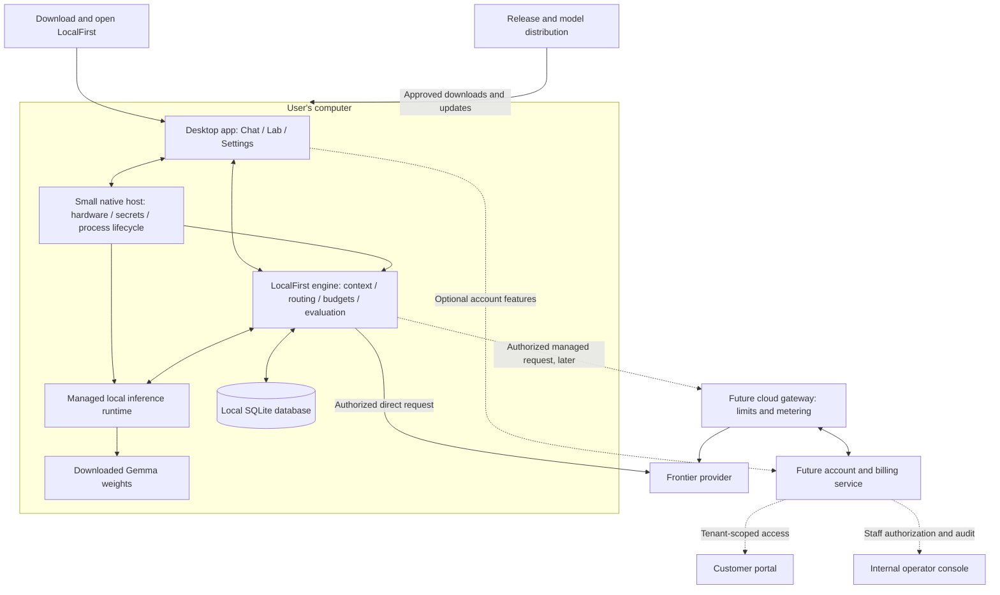
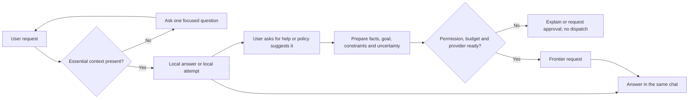

# LocalFirst — product architecture

**Executive summary · Updated November 17, 2026 · Proposed direction**

LocalFirst should feel like opening a chat app: suitable work happens locally;
stronger help stays in the same conversation, under clear privacy and spending choices.
Our product is the dependable setup, context, quality and support around that loop.

**Recommendation: ship one desktop app around the engine we already have.** Start with
Apple Silicon, one recommended Gemma model, and local chat without an account. Keep
the engine independent of the window so an extension or API can reuse it later.

**Immediate milestone: use the product for ordinary daily work for about a week.**
Fix the friction that appears. Marketing, billing and customer/staff admin work stay
deferred until that week has been reviewed; the architecture below preserves their
future boundaries without making them current tasks.

**November 20 scope update:** simple PDF text uploads are now part of daily-use work.
The app extracts page text locally, retains it with chat, and reports excerpt coverage.
Original-file archiving, OCR, other attachment types and web browsing remain separate.

| Decision | Recommendation |
| --- | --- |
| What users install | One signed app managing its engine/runtime. No separate Python or Ollama setup. |
| What users see | Chat first; compact Lab and Settings. Ordinary buttons for setup and recovery. |
| What stays local | Conversations, context preparation, model weights, evaluation records, and the default inference ledger. |
| What can leave | An authorized frontier request; separately disclosed downloads, update checks, and optional diagnostics. |
| What we reuse | Existing UI, FastAPI, SQLite, streaming, Markdown, providers and real-chat Lab. |
| What we improve first | The everyday chat/help loop, reliability and opening/resuming the app; fix issues found during personal use. |
| What stays deferred | Marketing, billing, customer/staff admin, file access, chat organization, autonomous workers and team deployment. |
| First evidence | A week of real personal use and saved chat examples; revisit customer discovery and business infrastructure afterward. |

**Setup target: under one minute excluding actual downloads, with five clicks maximum
on the normal recommended path.** Guide each step, explain the hardware recommendation,
and arrive at a ready chat without technical choices or a mandatory account. Track
download time separately; installation, permission prompts, verification and loading
still count toward setup. This is a target to validate, not an implemented result.

Product decisions are below; implementation requirements are in the
[engineering notes](docs/architecture/engineering-notes.md). See [VISION.md](VISION.md)
for scope and the [discovery map](docs/research/customer-landscape-2026-11-16.md) for customer hypotheses.

## 1. The whole system

**One installation; two owned backend processes:** application engine and inference
runtime, with separate failure/recovery paths. The runtime may spawn workers internally.
Local chat/history remain available when our website, billing or frontier service fails.

| Boundary | Owns | Must stay outside it |
| --- | --- | --- |
| Interface | Rendering, navigation, input, selection, streaming presentation | Provider keys, budget enforcement, model policy |
| Native host | OS hardware APIs, credential storage, signed updates, launching/reaping owned processes | Prompts deciding which commands may execute |
| Engine | Context, handoff, consent checks, reservations, storage, Lab, normalized inference events | Desktop-window assumptions or tenant administration |
| Runtime | Loading weights and generating tokens on local hardware | Product billing, user identity, cloud fallback decisions |
| Optional online service | Accounts, entitlements, managed cloud billing, release operations | Default custody of local chat history |

## 2. Delivery choices: choose one now, preserve the useful seams

| Form | Strength | Cost or constraint | Decision |
| --- | --- | --- | --- |
| Desktop app | Owns installation, hardware checks, model storage, offline use | Signing, updates, OS testing | **First product candidate** |
| Hosted website + local worker | Browser interface with local inference | Still needs a local install, connection security and browser permissions | Later if customers prefer it |
| Browser-only inference | Can avoid a native install | Model download, browser storage and hardware/runtime constraints remain | Separate experiment, not the launch dependency |
| VS Code extension | Meets developers inside their workflow | Excludes many nontechnical users; still needs inference setup | Only after developer demand is validated |
| API/SDK or shared office engine | Fits existing automation and high-volume teams | Integration, authentication and concurrent workloads | Later, if discovery favors this buyer |

A website **can** use local inference, but browser-to-local connections introduce
permissions and connection security. [Chrome includes localhost in its access controls](https://developer.chrome.com/blog/local-network-access).
Desktop is the recommended first experience, not a permanent restriction.

**Packaging candidate:** Tauri 2 + packaged Python engine + existing UI. Prove it first;
use Electron if actual WebView incompatibilities justify its larger shell. Avoid engine
or native-UI rewrites. [Comparison and sources](docs/architecture/engineering-notes.md#1-desktop-packaging-decision).

## 3. First run: guided setup, five clicks maximum

The five-click budget covers the normal path from getting/opening the app to a ready
chat, including required install/launch actions and OS permission confirmations.
Keyboard activations count too. The steps below describe states, not five extra
wizard buttons. Automatic transitions should carry the user through preparation into
chat; no model jargon, repeated confirmations or separate runtime installer.

| Step | User experience | Behind the interface |
| --- | --- | --- |
| 1. Open | “Run privately on this computer.” No mandatory account. | Start the bundled engine; check supported OS/architecture. |
| 2. Choose setup | **Recommend for my computer** or **Enter hardware manually**, with plain explanations and a clear default. | Read hardware locally, or use entered specifications. No file/content scan or hardware upload. |
| 3. Approve | “Recommended: Lightweight Gemma. Download X GB; needs Y GB free. [Download & start]” | Show exact artifact size, storage headroom, model source/license and an honest ETA. |
| 4. Prepare | Explain what's happening and what's next; progress, pause/cancel, resume, and useful failure messages. | Download, verify, load, and perform a short local readiness check. |
| 5. Chat | Move straight into chat when ready, with **Running locally** status. Frontier setup can wait. | Model is ready, context is bounded, history persists. |

Manual entry skips optional hardware inventory; minimal platform/allocation checks
remain necessary. Explain the distinction. Hardware detection does not grant access to
personal folders; this product needs no broad desktop or Full Disk Access permission.
Manual entry is an optional branch with additional fields, not friction imposed on the
recommended path. Measure that branch separately and keep its guidance equally clear.

| Clock | Proposed target; not a measured result |
| --- | --- |
| Setup excluding downloads | Under 60 seconds to a ready chat; subtract actual app/runtime/model transfer time only. |
| Required interactions | At most five clicks/activations on the normal recommended path, including mandatory OS prompts. Validate the actual installer path. |
| Download wait | Separate progress/ETA; no one-minute cap on transfer time. |
| Full elapsed journey | Record alongside the setup metric to understand abandonment and recovery; download duration does not determine whether the one-minute setup target passes. |
| Reopening an installed app | Immediate usable interface; measure cold model load and warm first-content latency separately. |

**Illustrative transfer times:** decimal GB, sustained Mbps, nearest second. Add app
installation, verification and loading. Gemma E2B currently lists approximately 4.6 GB
and 7.5 GB backend variants, not RAM requirements. [Artifacts](https://ollama.com/library/gemma4:e2b)

| Model transfer | 100 Mbps | 500 Mbps | 1,000 Mbps |
| --- | --- | --- | --- |
| 4.6 GB | 6m 08s | 1m 14s | 37s |
| 7.5 GB | 10m 00s | 2m 00s | 1m 00s |

`seconds = GB × 8,000 / Mbps`. Bundling weights moves the wait into installer download.
A smaller starter is worthwhile only if useful-task quality passes.

## 4. Hardware → model recommendation

Use a small, versioned compatibility catalog and deterministic rules. **Do not ask an
LLM to guess which model fits a computer.**

| Input | Why it matters |
| --- | --- |
| OS, CPU architecture, supported instruction/backend features | Whether the exact runtime/artifact can execute |
| Total RAM and current memory pressure | Whether weights, context and working buffers fit while other apps run |
| GPU/backend support and usable GPU memory | Whether acceleration is available; unified memory must not be counted twice |
| Free space on the chosen volume | Weights + partial transfers + runtime/update staging + safety headroom |
| User preference | Faster replies versus more capable local answers; download and battery constraints |
| Short post-install measurement | Actual loading, first-content latency, output rate and memory behavior |

Native APIs expose RAM and recommended GPU working-set size; neither guarantees speed.
[Physical memory](https://developer.apple.com/documentation/foundation/processinfo/physicalmemory),
[Metal working set](https://developer.apple.com/documentation/metal/mtldevice/recommendedmaxworkingsetsize).

**Memory rule:** weights + context cache + runtime buffers + OS/other-app headroom must
fit. Context and concurrency matter; CPU count and parameter labels do not predict speed.

| Profile | Initial policy |
| --- | --- |
| Apple Silicon, 16 GB or more | Initial pilot candidate; Gemma 4 E2B is already used on the founder's M4/16 GB. Publish only configurations that pass release tests. |
| 8 GB or constrained memory | No launch promise yet. Qualify a smaller artifact/model before offering it. |
| Windows GPU / Windows CPU / Intel Mac / Linux | Separate compatibility work, not an implied benefit of a cross-platform shell. |
| Unknown or insufficient hardware | Explain the missing requirement; allow correction or stop setup. Never silently turn this into cloud chat. |

Start with **one Lightweight Gemma**, honoring the US-based developer preference;
a more capable local Gemma can be an optional later download. Keep formats, sizes,
context and licenses in the catalog. Google DeepMind's Gemma 4 specifies Apache 2.0;
verify artifact notices too. [Model card](https://ai.google.dev/gemma/docs/core/model_card_4)

## 5. Own model setup without owning a model runtime

| Build | Reuse |
| --- | --- |
| Recommendation, consent, catalog, progress UI, recovery, compatibility qualification | Ollama's inference, supported acceleration and model transfer machinery |
| Our chat, context policy, handoff, Lab and cost accounting | Proven OS credential stores, installer/signing/update tooling |

**Pilot runtime:** pinned, app-managed Ollama with a private model directory and owned
lifecycle. Preserve external services, configuration and models. Optional reuse of a
compatible installation requires explicit choice; never silently duplicate GB of weights.

Catalog entries pin artifact identity, release/knowledge dates, size, license, backend,
context and tested hardware. Resume interruptions, verify before activation, and retain a working version
during upgrades. A moving upstream tag must not silently change a release.

First prove redistribution, acceleration, signing and lifecycle. Reuse download/resume
machinery. [Runtime requirements](docs/architecture/engineering-notes.md#2-managed-runtime-and-artifact-lifecycle).

## 6. One engine owns the conversation

These are module boundaries inside the existing application, not separate services.

| Module | Responsibility |
| --- | --- |
| Chat/context | Save messages, assemble role-preserving inputs, enforce token/output budgets, disclose omitted context. Archive length is not model context length. |
| Handoff/preparation | Identify missing essentials; prepare goal, facts, constraints, uncertainty and source excerpts. Preserve the original request. |
| Policy/budgets | Decide what is permitted, reserve cost before dispatch, record reasons, enforce consent and limits independently of model text. |
| Provider adapters | Normalize local/frontier streams, capabilities, usage, errors and cancellation. No hidden retries or provider swaps. |
| Setup/catalog | Hardware recommendation, download state and readiness; ask the host only for narrowly defined native operations. |
| Persistence/telemetry/Lab | One history and inference ledger; immutable evaluation inputs, reviews and comparisons. |

Two contracts initially: **provider streaming** and **runtime lifecycle**. Ordinary
modules/functions suffice. Keep `app/main.py` for composition/HTTP; extract changing
orchestration. Preserve ordered streaming, Markdown, cancellation and exact saved text;
add crash recovery. [Transport/lifecycle details](docs/architecture/engineering-notes.md#3-local-transport-and-response-lifecycle).

## 7. Frontier help: useful context before expensive reasoning

An explicit frontier request may skip the local attempt. Avoid an extra proofreading
call on every message: use cheap checks first; selective preparation must earn its
latency and cost in the Lab.

| Rule | Product behavior |
| --- | --- |
| Missing information | Ask for essential missing facts. Do not fabricate a complete brief or make users fill an experiment form. |
| Preparation | Show a concise editable preview for manual handoff; retain source roles/excerpts and mark assumptions. Summaries are lossy, not ground truth. |
| Routing | Manual “Get stronger help” first. Preserve existing four-mode implementation; automatic mode needs evidence beyond a self-reported confidence score. |
| Authorization | Permission states specify provider, purpose and content scope. Lab judging is another cloud use, not implied by importing a chat. |
| Cost | Atomic reservation before dispatch, bounded inputs/output, no unapproved retries. Retain unresolved charges when usage is missing. Cancellation may still incur a provider charge. |
| Fresh facts | A stronger model alone does not supply current information. If grounded retrieval is unavailable, disclose that limitation or ask for a source. |
| Result | Keep local and frontier attempts linked, show provenance, preserve useful history. Frontier critique is evidence, not proof of correctness. |

| Cloud connection | When | User/account implications |
| --- | --- | --- |
| Direct provider with user's key | Technical pilot; existing OpenAI work is the starting adapter | Optional Settings UI saves key in OS credential storage. No terminal/environment setup for customers. Device-local cap covers this installation only. |
| LocalFirst-managed access | Before claiming effortless frontier help for nontechnical public users | One optional account and payment flow. A small hosted gateway holds our provider keys, enforces account-wide reservations, and meters usage without persisting request bodies. Explicitly disclose the extra processor. |

Keep one provider interface. Never embed our API key in the app or require cloud setup
for local chat. Resolve ownership, margin and provider terms before selling managed
access; consent must cover the chosen transmission path.

## 8. Data, permissions and operational trust

| Area | Product rule |
| --- | --- |
| Chats, context, Lab and telemetry | One local SQLite database in the OS application-data directory; no default upload. Current storage is plaintext: never claim encryption we have not implemented. |
| Credentials | OS credential store; never prompts, browser storage, logs or exports. |
| Hardware | Read locally, explain the fields, allow manual entry; no personal-folder or network inventory. |
| Models/runtime | Separate replaceable downloads from irreplaceable conversations. Track what we own; leave external installations alone. |
| Network | Cloud, diagnostics and updates have distinct choices. Downloads/update checks expose connection metadata; local chat works offline after setup. |
| Recovery | Consistent backups, history import/export, transactional migrations, verified signed updates and recoverable setup errors. |
| Access | Authenticated loopback engine, narrow native commands, sanitized Markdown. A model cannot grant itself permissions or override a budget. |
| Support and deletion | Previewable redacted diagnostics; no staff backdoor into chats. Explain which chats, models and logs deletion removes. |

Decide offline license grace and retention before charging. Sensitive-sector use needs
a qualified protection/recovery design. [Implementation details](docs/architecture/engineering-notes.md).

## 9. Four surfaces, built when they have a job

| Surface | Build when | Scope |
| --- | --- | --- |
| Product app | Now | Chat, small Lab, ordinary Settings, model setup |
| Public website | Deferred until after the personal-use week and product review | Promise, honest requirements, demo, signed downloads, privacy, docs, contact |
| Customer portal | Deferred; later paying accounts/teams justify it | Devices, licenses, spending, invoices/contracts; team roles and policies only when needed |
| Internal operator console | Deferred; later hosted operations justify it | Release health, accounts, billing exceptions and audits; no default access to private chats |

Share a web repository/design system if useful, with separate customer/staff
server authorization and audit. One later hosted application can use managed auth,
a relational database and payments. Four surfaces do not require four backends or
cloud copies of chats.

## 10. Quality and economics: the Lab is our evidence loop

| Question | Evidence |
| --- | --- |
| Was the answer useful/correct? | Review real completed chat turns against explicit criteria and references; record pass, fail, insufficient context or uncertain with evidence. |
| Did preparation help? | Compare original inputs with prepared inputs; distinguish added facts from wording improvements. Include preparation latency and tokens. |
| Is frontier help worthwhile? | Compare local, hybrid and an appropriately optimized cloud baseline on the same task and acceptable-quality threshold. |
| Is speed acceptable? | Cold/warm first-content latency, total task wait, output rate, long-history behavior, memory pressure and failure rate by artifact/device. |
| Did spend actually fall? | Metered charges and total cost per successful task, including retries, support, hardware/power estimates and LocalFirst fees. Fixed subscriptions are not automatic cash savings. |

Every chat is potential test material; automatic paid judging is optional. Keep sampled
comparisons and a stable regression set from consented examples, with predeclared
criteria. Withhold references from generation; ground verdicts in evidence and human or
deterministic checks, not just a frontier judge's agreement.

## 11. Grow without turning this into an agent platform

| Later capability | Reuse | Add only when requested |
| --- | --- | --- |
| Chat folders/indexing | Existing local conversations | Start with SQLite full-text search; proposed labels/folders, provenance and undo. Add embeddings only when keyword search proves insufficient. |
| Additional attachment types / folders | PDF text upload and existing context/permission boundaries | Explicit selected paths, scoped access/revocation, size limits, safe parsers, provenance and deletion; no blanket disk access. |
| Recurring local worker | Engine, ledger, model lifecycle | Durable bounded jobs, checkpoints, idempotent actions, resource/power schedules and approval for external effects. Sleeping laptops are not 24/7 servers. |
| Extension/API client | Same application services | Narrow authenticated interface and supported integration; no duplicate routing logic. |
| Shared team machine | Provider/context contracts | Real multi-user isolation, scheduler, encrypted transport, quotas and tenant tests. Not just binding the prototype to a LAN address. |

Local tokens still consume hardware, power and attention. Workers need bounded tasks;
cloud also improves. Our advantage must survive a real customer's workflow comparison.
Better chips/models should change the qualified catalog choice, not require a new app
architecture. Qualify upgrades against saved tasks before promoting a new default.

## 12. Implementation order and release gates

One repository: retain `app/`, `app/static/`, `tests/`, `docs/`; add `desktop/` for the
host and `distribution/` for builds/catalogs. No preliminary directory reshuffle.

| Stage | Concrete deliverable | Gate to proceed |
| --- | --- | --- |
| **1. Make daily use comfortable** | Focused chat/help flow, readable responses, reliable history/Stop/recovery | Can open, ask, clarify, get authorized stronger help and resume without recurring technical interruptions. |
| **2. Use it for a week** | Real daily tasks in the existing app; saved examples and brief friction notes | Review roughly a week of ordinary use. Fix recurring blockers; identify useful tasks, failures and remaining limits before considering business work. |
| **3. Package and guide setup** | Signed desktop app, owned runtime, one recommended model, automatic/manual hardware flow | Clean supported Mac needs no developer tools; normal setup meets the five-click/under-one-minute target excluding downloads. Resume, verification and resource errors recover cleanly. |
| **4. Consider a narrow pilot** | Only after the personal-use review: uncoached users on supported devices and workflow interviews | Validate onboarding, quality and economics on actual workflows before wider distribution. Marketing remains a separate later decision. |
| **5. Consider paid operations** | Later, only if needed: account/billing gateway, customer portal and staff tools | Account-wide spend controls, tenant/staff authorization and payment reconciliation tested before charging. |

Use the current app for the week; production packaging is not a prerequisite. Do only
the launch/setup work needed to make daily use convenient. Fix issues as they arise,
using saved chats and the existing Lab when helpful; no new feedback dashboard or
mandatory evaluation ritual. At the end, ask whether this is a tool the founder
naturally reaches for and trusts, then choose the next product improvement.

See [release checks](docs/architecture/engineering-notes.md#5-release-verification).
Keep a narrow support matrix; add infrastructure for demonstrated requirements.

## 13. What exists versus what this brief proposes

| Already in the repository | Productization gap |
| --- | --- |
| Local streaming chat, Markdown, persistence, telemetry | Packaged install, owned lifecycle, crash-tail checkpoints and polished recovery |
| Ollama adapter, installed-model discovery, preferred Gemma | Managed runtime, hardware recommendation, consented verified model setup |
| OpenAI adapter, handoff, four routing modes, local daily reservations | Customer credential UI/storage, release-grade context/cost bounds, broader provider/account controls |
| Real-chat Lab, input snapshots, review records | Reliable task-quality evidence and selective comparisons; no assumption of a proven automatic judge |
| Loopback development server with origin/host checks | Packaged session authentication, native scopes, signing, updates and clean-machine verification |
| Local plaintext SQLite | Product data directory, migration/import/export UX, documented security/support policy |
| PDF text uploads, page-labelled context, local follow-ups | OCR/visual understanding, other formats and original-file management remain deferred |

**Next:** make the existing app comfortable for everyday work, then use it for about a
week and fix the observed friction. Packaging/onboarding follows that experience;
marketing, billing and admin surfaces remain later. Buyer, pricing and broad platform
support stay open.

Sources checked November 16, 2026. Timing/support targets and rollout gates are
proposals; arithmetic is illustrative. No new benchmark or savings result is claimed.
